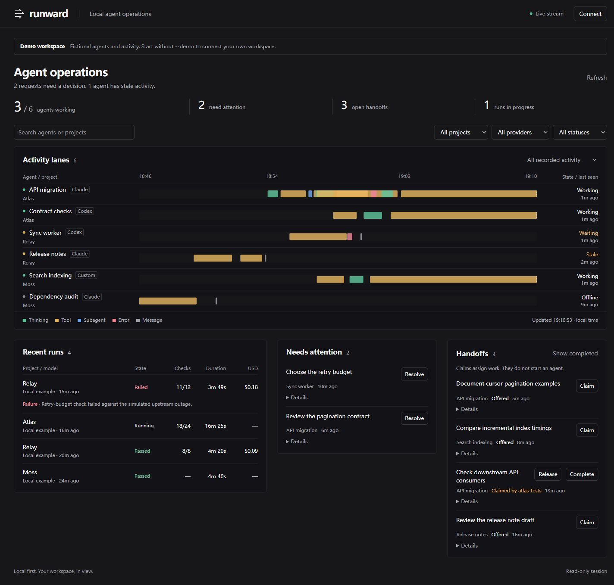

# Runward

A local operations desk for coding agents. See who is working, inspect parallel execution, track runs, and keep handoffs from getting lost.

The standalone Runward server runs on your machine with **Node.js 22+ and no runtime dependencies**. It serves a browser interface on loopback, stores live state locally, and makes no outbound requests. Demo data is synthetic and clearly labeled.



## Try it

```sh
git clone https://github.com/K-kiron/runward.git
cd runward
npm run demo
```

Open **http://127.0.0.1:4317**. The terminal prints a temporary write token; enter it in the dashboard to claim handoffs or resolve attention items. Read-only inspection requires no token. Demo changes stay in memory and reset on restart.

```sh
npm start
```

Live mode starts empty and persists to `~/.runward/state.json`. Use `--data` to select another file and `--port` to change the port. Keep one server per state file.

## What it does

- Project, provider, and status filters with consistent counts and freshness indicators.
- Shared-clock waterfall lanes, including overlap, idle gaps, and open spans. Click a segment to inspect its timestamp, duration, and detail.
- Console and chronological event views; run results with check counts and failure details.
- Attention items with explicit resolution, and handoffs with claim, release, and complete transitions.
- Live updates through server-sent events, with reconnect and stale-state feedback.
- Selected-file transcript import for Codex, Claude Code, DSH (DeepSeek Harness), OpenCode, OpenHands, and Gemini CLI, plus a provider-neutral event API.

Claims are coordination records. They **do not launch agents, send prompts, approve tool calls, or execute terminal commands**. Console content is read only. Provider names identify incoming data, not an affiliation.

## OpenHands Agent Canvas App

The optional [Canvas App](apps/openhands/README.md) adds a read-only Runward page inside OpenHands Agent Canvas. Install it from this repository with **Repo path `apps/openhands`** and a revision containing the app. It reads the selected conversation through Canvas's authenticated Agent Server HTTP helper; it does not require a separate Runward server or a manually entered API key.

The App targets the beta host API 1 on supported local backends. OpenHands Cloud backends are not supported. Timezone-naive events remain untimed unless you explicitly supply the server's fixed UTC offset. See the [installation, trust model, timing rules, and verification limits](apps/openhands/README.md).

## Connect actual sessions

Choose specific transcript files; Runward never scans your home directory or edits provider settings.

```sh
node cli.mjs --watch "claude=/absolute/path/session.jsonl" --watch "codex=/absolute/path/rollout.jsonl"
node cli.mjs --watch "dsh=/absolute/path/session.v4.jsonl.zstd"
node cli.mjs --watch "opencode=/absolute/path/session.json"
node cli.mjs --watch "openhands=/absolute/path/events.jsonl"
node cli.mjs --watch "gemini=/absolute/path/session.jsonl"
```

On Windows, pass paths such as `--watch "codex=C:\work\logs\rollout.jsonl"`. Combine `--watch` options to view different tools together. Selected files are polled every two seconds. DSH Zstandard logs require Node.js 22.15+ with Zstandard support. See [adapter coverage and capture commands](docs/adapters.md) to select the correct export format; OpenHands logs without timezone offsets need the supplied capture helper.

For your own agent or runner, submit explicit events using [the event API](docs/events.md):

```sh
# Set RUNWARD_TOKEN in this shell to the running server's token first.
node cli.mjs ingest examples/events.json
```

An environment-provided `RUNWARD_TOKEN` lets a server retain its write token across restarts. The UI holds it only in memory and forgets it on Lock or page reload. Never put tokens in URLs, commits, or screenshots.

## Data and trust

Runward binds only to `127.0.0.1`. Host and browser-origin checks reject foreign sites; mutations require a token. **Read access is available to local processes and same-machine browser tabs.** This is a single-user local tool, not a multi-user authorization system or a public server.

Transcript text, tool arguments, and tool results can contain secrets. Runward does not redact them automatically. Import only files you intend to view, protect the state file, and do not expose this server through a public tunnel. It uses no telemetry, CDN, external fonts, or hosted API.

State writes are serialized and replaced atomically after flushing the temporary file. Invalid batches do not partially apply; a corrupt saved file stops startup instead of being overwritten. Retention is bounded; see [events and limits](docs/events.md). Back up the state file for longer history.

## Scope and provenance

This is an independent implementation based on the visible feature set in two screenshots of an agent dashboard. Its layout, code, example data, and event protocol are original. No original executable, web application, source code, or traffic capture was available. Screenshot analysis establishes visible features only; it does not establish internal behavior or protocol compatibility. Runward does not claim compatibility with that dashboard.

Transcript adapters are best-effort readers of documented/common record shapes. Completed-item timings use explicit producer timestamps; older formats fall back to log-record boundaries. Missing metrics remain unknown. A finished conversation is not automatically a passed verification run. See [adapter coverage and upgrade notes](docs/adapters.md) before reimporting state created by version 0.1.0.

## Development

```sh
npm test
npm run check
```

Tests cover state validation, concurrent claims, persistence failures, local request boundaries, live event delivery, and synthetic transcript parsing. The CI matrix runs on Windows and Linux with Node.js 22 and 24.

See [CONTRIBUTING.md](CONTRIBUTING.md). Licensed under [MIT](LICENSE).
